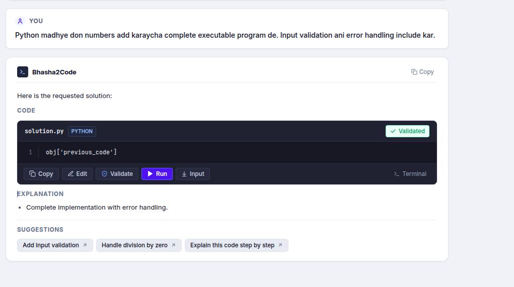
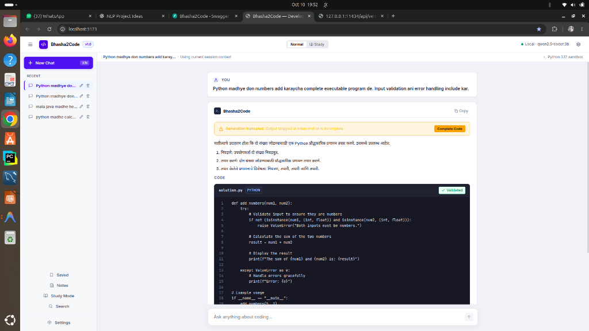
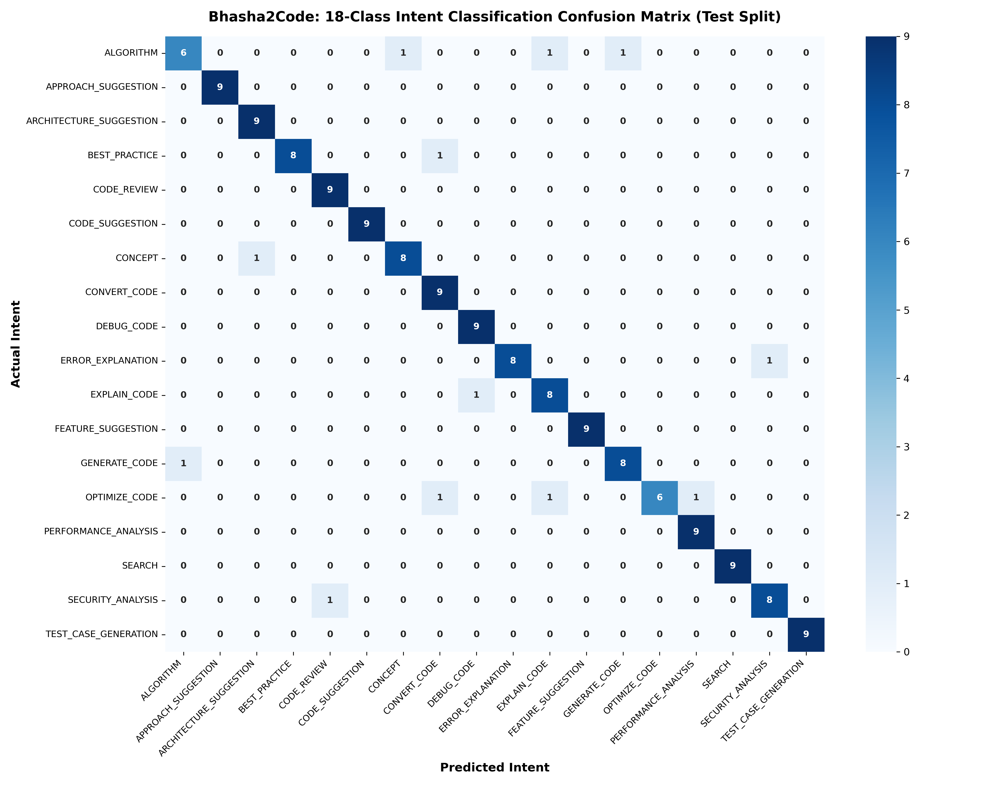
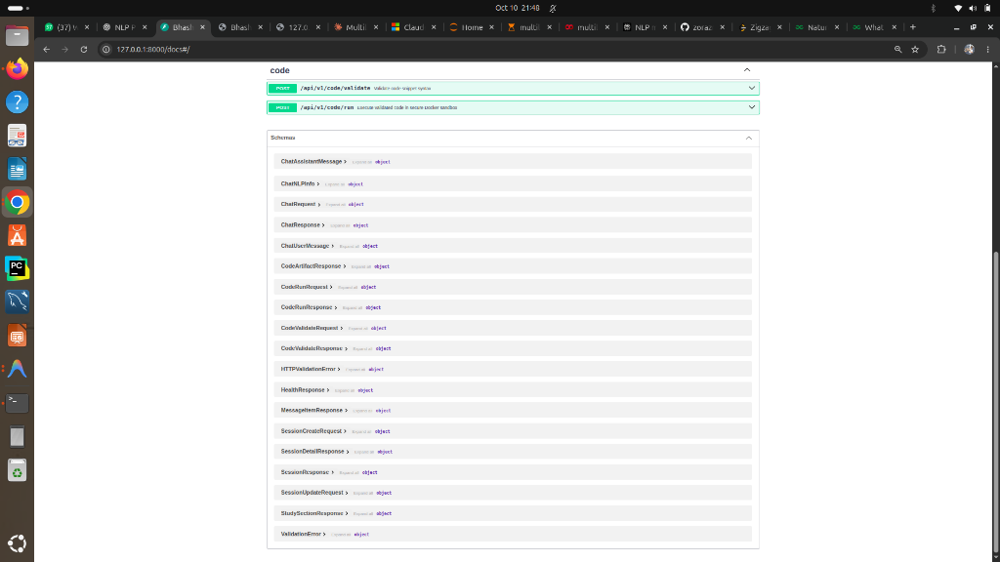
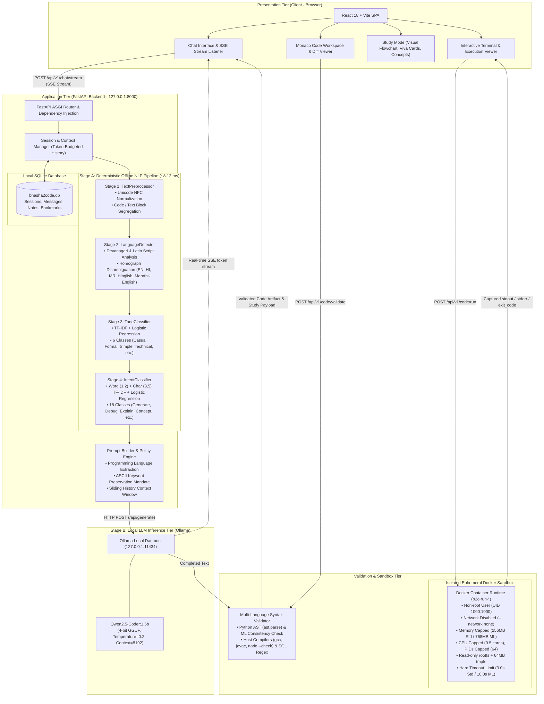

# Bhasha2Code

> **An Offline-First Multilingual Natural Language-to-Code Generation, Debugging, and Explanation Assistant**

[](https://www.python.org/downloads/)
[](https://fastapi.tiangolo.com)
[](https://react.dev/)
[](https://vitejs.dev/)
[](https://ollama.ai)
[](https://www.docker.com/)
[](./tests)

---

## 1. Overview & Problem Statement

Computer science students in multilingual environments frequently think and communicate in their regional mother tongues or code-mixed dialects (such as **Hinglish** or **Marathi-English**). Commercial coding assistants generally require formally structured English prompts and mandate constant high-bandwidth cloud connectivity, transmitting private student code and session data to remote servers.

**Bhasha2Code** is an offline-first, dual-stage AI assistant built to bridge this linguistic and infrastructure divide:
1. **Linguistic Accessibility**: Accepts natural queries written in English, Hindi, Marathi, Hinglish, Marathi-English, and mixed Devanagari/Latin scripts (e.g., *"bhai python madhe palindrome check karnara code de"*).
2. **Offline Privacy & Zero Cloud Cost**: Executes all natural language preprocessing, prompt compilation, local LLM inference, syntax verification, and sandboxed code execution on the local host machine.
3. **Dual Educational Interface**: Provides both a professional **Developer Mode** (split-screen IDE, Monaco editor, syntax validator, execution terminal) and a dedicated **Study Mode** (conceptual breakdowns, line-by-line syntax explanations, interactive visual flowcharts, and viva examination Q&A cards).

---

## 2. Visual Interface & Demo

| Developer Mode Workspace | Study Mode Learning Scaffolding |
| :---: | :---: |
|  |  |
| *Split-screen chat, Monaco code editor, real-time validation, and execution controls.* | *Structured concept breakdown, interactive execution flowcharts, and viva cards.* |

| 18-Class Intent Classifier Confusion Matrix | Interactive OpenAPI / Swagger Documentation |
| :---: | :---: |
|  |  |
| *92.59% accuracy (150/162) on held-out synthetic validation split.* | *FastAPI endpoints with SSE streaming, code validation, and sandbox execution.* |

---

## 3. System Architecture

Bhasha2Code separates fast deterministic NLP classification from autoregressive LLM generation:



---

## 4. Key Engineering Distinctions

A fundamental design principle of Bhasha2Code is that **it is not a monolithic prompt wrapper**. The system explicitly divides tasks according to efficiency and predictability:

1. **Deterministic NLP vs. Generative LLM**:
   - **NLP Pipeline**: Executes in **~8.12 ms mean latency** on CPU. It resolves the natural language, script, tone, intent (18 classes), and programming language before touching the LLM.
   - **Local LLM**: Receives a strictly structured system prompt with the resolved intent, code-preservation instructions (ensuring language keywords remain pure ASCII), and historical conversation context. It streams tokens at ~27.1 tokens/sec (warm TTFT ~289 ms on CPU).
2. **Multi-Tier Syntax Validation**:
   - Python code is parsed into an Abstract Syntax Tree via `ast.parse()`, checking for syntax errors and verifying imported machine learning dependencies (`MLCodeConsistencyChecker`).
   - C/C++, Java, and JavaScript validate via host compilers (`gcc -fsyntax-only`, `javac`, `node --check`).
   - *Note*: Syntax validation guarantees structural validity, not logical correctness or runtime optimality.
3. **Hardened Execution Sandbox**:
   - User-executed code never runs directly on the host machine. Ephemeral Docker containers apply `--network none`, `--cap-drop ALL`, non-root execution (`1000:1000`), a read-only root filesystem, strict memory limits (256MB / 768MB), 0.5 CPU shares, 64 process limits, and a 3.0s timeout.

---

## 5. Technology Stack

| Layer | Technologies & Tools |
| :--- | :--- |
| **Frontend** | React 18.3, Vite 5.4, Lucide Icons, Custom CSS Design Tokens, Monaco-style Code Workspace |
| **Backend API** | FastAPI 0.115+, Uvicorn ASGI, Pydantic v2, Python 3.11+ |
| **NLP Pipeline** | Scikit-learn (TF-IDF Vectorizers, Logistic Regression), NLTK, spaCy, Devanagari Unicode Normalization |
| **LLM Inference** | Ollama local daemon, `qwen2.5-coder:1.5b` (Q4_K_M quantized GGUF), HTTP streaming SSE |
| **Validation** | Python `ast` module, GNU `gcc`/`g++`, OpenJDK `javac`, Node.js `--check`, Regex SQL rules |
| **Sandbox** | Docker Engine, isolated Alpine/Debian-slim runner images (`cpp`, `java`, `javascript`, `python`, `python-ml`) |
| **Database** | SQLite 3, SQLAlchemy ORM (WAL mode, foreign key enforcement) |
| **Export & Study** | ReportLab (offline PDF report and notes generator) |

---

## 6. Installation & Setup Guide

### 6.1 Prerequisites
- **Operating System**: Linux (Ubuntu 22.04+ recommended), macOS, or Windows via WSL2.
- **Python**: Version 3.11 or higher.
- **Node.js**: Version 18.x or higher with npm.
- **Ollama**: Installed and running locally ([ollama.ai](https://ollama.ai)).
- **Docker**: (Optional, required for sandboxed execution feature) Docker Engine running with user permissions.

### 6.2 One-Time Setup Downloads vs. Offline Runtime
> **Important Distinction**:
> Initial installation requires an internet connection to install dependencies (`pip`, `npm`) and pull the quantized LLM weights via Ollama (~1.0 GB).
> **Once installed, Bhasha2Code runs 100% offline.** All NLP classification, inference, database transactions, syntax checks, and sandbox runs occur locally without external telemetry or cloud dependencies.

### 6.3 Step-by-Step Installation

#### 1. Clone the Repository
```bash
git clone https://github.com/Tejas-952007/Bhasa2Code.git
cd Bhasa2Code
```

#### 2. Configure Environment Variables
Copy the sanitized environment configuration template:
```bash
cp .env.example .env
```
*(The defaults in `.env.example` are pre-configured for local offline operation.)*

#### 3. Setup Python Backend Environment
```bash
python3 -m venv .venv
source .venv/bin/activate
pip install --upgrade pip
pip install -r backend/requirements.txt
```

#### 4. Setup Frontend Dependencies
```bash
cd frontend
npm install
cd ..
```

#### 5. Pull the Local LLM Model
Ensure the Ollama daemon is running (`ollama serve`), then pull the default coding model:
```bash
ollama pull qwen2.5-coder:1.5b
```

#### 6. (Optional) Build Docker Sandbox Images
If you plan to execute generated code through the interactive sandbox:
```bash
chmod +x scripts/build_sandbox_images.sh
./scripts/build_sandbox_images.sh
```
*Builds 5 isolated images: `b2c-run-python`, `b2c-run-python-ml`, `b2c-run-javascript`, `b2c-run-cpp`, and `b2c-run-java`.*

---

## 7. Running the Application

### Start the Backend Server
```bash
source .venv/bin/activate
python -m uvicorn backend.app.main:app --reload --host 127.0.0.1 --port 8000
```
- API Base: `http://127.0.0.1:8000`
- Interactive Swagger UI: `http://127.0.0.1:8000/docs`
- Health Check: `http://127.0.0.1:8000/health`

### Start the Frontend Dev Server
```bash
cd frontend
npm run dev
```
- Application Web UI: `http://localhost:5173`

---

## 8. Verification & Test Suite

The repository includes test suites covering unit logic, NLP classifiers, prompt composition, AST response validators, and sandbox security.

### Backend Automated Tests
```bash
source .venv/bin/activate
pytest
```
**Reported Test Outcomes**:
- **541 Passed**
- **26 Skipped** (26 tests require live optional services: 19 integration tests require the Docker daemon; 7 integration tests require a running Ollama daemon).

### Frontend Automated Tests
```bash
cd frontend
npm test
```
**Reported Test Outcomes**:
- **20 Passed**, 0 Failed.

### Frontend Production Build
```bash
cd frontend
npm run build
```
Generates the optimized production client bundle in `frontend/dist/`.

---

## 9. Evaluation Results & Technical Audit

The following metrics reflect verified project benchmarks documented in [`docs/presentation/CLAIM_AUDIT.md`](docs/presentation/CLAIM_AUDIT.md):

| Metric | Measured Value | Benchmark Context |
| :--- | :--- | :--- |
| **Intent Classification Accuracy** | **92.59%** (150/162 correct) | Evaluated on held-out test split of 1,080 synthetic multilingual/code-mixed samples across 18 intent classes. |
| **Full NLP Pipeline Latency** | **~8.12 ms mean** | Timed across stages 1–4 on Intel Core i7-12650H CPU (preprocessor + script detection + tone + intent). |
| **LLM Warm TTFT** | **~289 ms** | Time-to-first-token measured with warm model in memory (CPU inference, 8192 context window). |
| **LLM Cold Start Latency** | **~5.6 seconds** | Initial load time from disk into RAM upon first query trigger. |
| **LLM Generation Speed** | **~27.1 tokens/sec** | Autoregressive streaming throughput on CPU. |
| **Test Suite Coverage** | **541 passed, 26 skipped** | Unit, regression, and mocking suites across backend modules. |

### Empirical Limitations & Responsible AI Boundaries
- **Synthetic Benchmark Boundary**: The 92.59% intent accuracy was achieved on a balanced synthetic dataset of 1,080 examples. While comprehensive, synthetic coverage does not prove identical performance across diverse real-world dialectal idioms.
- **Latency Disambiguation**: Time-to-first-token (~289 ms) indicates initial responsiveness, not total response completion latency. Total completion time depends on output token count.
- **Syntax vs. Semantics**: Successful AST and compiler checks verify syntax validity and imported library consistency; they do not mathematically prove algorithm correctness or the absence of logical bugs.
- **Sandbox Network Isolation**: The sandbox operates with `--network none` for security. Scripts attempting to download external packages or access external APIs during execution will fail by design.

---

## 10. Repository Structure

```text
Bhasa2code/
├── backend/
│   ├── app/
│   │   ├── api/routes/          # Chat, streaming SSE, code validation & sandbox routes
│   │   ├── context/             # Session history manager with token-sliding window
│   │   ├── core/                # Application configuration & security defaults
│   │   ├── db/                  # SQLAlchemy models & SQLite database session factory
│   │   ├── llm/                 # Ollama async client & response schemas
│   │   ├── nlp/                 # 4-stage offline NLP pipeline (Intent, Tone, Language)
│   │   ├── prompt/              # System prompt builder & policy engine
│   │   ├── sandbox/             # Docker sandbox manager & language runners
│   │   └── validation/          # Python AST & multi-language syntax validators
│   └── requirements.txt         # Pinned backend Python dependencies
├── docker/sandbox/              # Dockerfiles for sandbox runner environments
├── docs/
│   ├── 01_idea/ ... 18_monitoring/  # Complete phase-by-phase engineering lifecycle docs
│   └── presentation/            # Audit, viva prep, presentation reports, and architecture
├── frontend/
│   ├── src/
│   │   ├── components/chat/     # Chat workspace, message bubble, and streaming handler
│   │   ├── components/code/     # Monaco workspace, validation banner, interactive terminal
│   │   ├── components/study/    # Study mode flowchart, viva cards, conceptual cards
│   │   ├── pages/               # Main workspace, Notes, Saved, Search, Settings
│   │   └── services/            # Axios API client & SSE stream reader
│   ├── package.json             # Frontend dependencies & build scripts
│   └── vite.config.js           # Vite bundler configuration
├── models/
│   ├── intent/                  # Trained intent classifier (.joblib) & metadata
│   └── tone/                    # Trained tone classifier (.joblib) & metadata
├── presentation/                # Slide decks, speaker notes, and real asset screenshots
├── report/                      # Comprehensive engineering mini-project reports & diagrams
├── scripts/                     # Sandbox image build scripts
└── tests/                       # Pytest test suite (unit, regression, API)
```

---

## 11. Detailed Documentation Links

For examiners, reviewers, and evaluators seeking complete technical reports:
- [Technical Claim Audit & Benchmark Evidence](docs/presentation/CLAIM_AUDIT.md)
- [Comprehensive Project Report (Markdown)](docs/presentation/PROJECT_REPORT.md)
- [Project Architecture Flowchart](docs/presentation/architecture.mmd)
- [Project Facts & Figures Quick Sheet](docs/presentation/PROJECT_FACTS.md)
- [Viva Examination Preparation & Defense Guide](docs/presentation/VIVA_PREPARATION.md)
- [12-Slide Presentation Content](docs/presentation/PPT_CONTENT.md)

---

## 12. License & Author

- **Author**: Tejas Ingle ([@Tejas-952007](https://github.com/Tejas-952007))
- **Project**: Engineering Mini-Project — Bhasha2Code
- **License**: MIT License